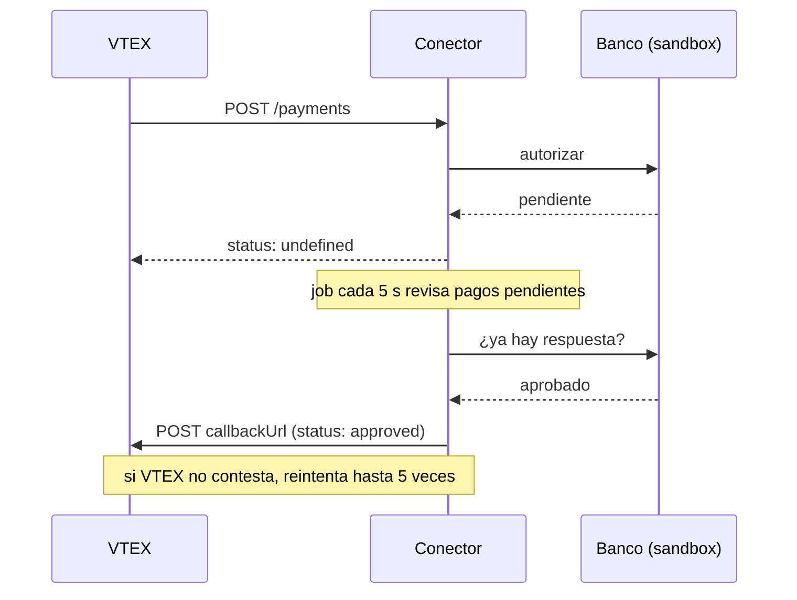

# vtex-payment-connector


Un conector de pagos para VTEX hecho en Java y Spring Boot. Implementa el
[Payment Provider Protocol](https://developers.vtex.com/docs/guides/payments-integration-payment-provider-protocol),
que es el contrato que usa VTEX para hablar con cualquier pasarela: autorizar, capturar,
reembolsar y cancelar un pago.

El banco que está detrás es de mentira (un sandbox con tarjetas de prueba). Lo demás es
lo que VTEX revisa cuando homologas un conector: que los reintentos no cobren dos veces,
que los pagos asíncronos avisen por callback, que las credenciales viajen en headers y que
las capturas parciales cuadren.

> Es un proyecto personal para mi portafolio. No tiene código de clientes ni de empresas donde he trabajado.

## Por qué lo hice

Trabajé más de un año con VTEX IO del lado de la tienda: componentes del storefront,
servicios en Node e integraciones. Desde ahí, el pago se ve como una caja negra: el checkout
lo manda "a la pasarela" y regresa aprobado o rechazado.

Quise construir esa otra mitad con lo que uso todos los días en backend (Java y Spring Boot)
para entender qué pasa cuando VTEX reintenta una llamada o cuando el banco tarda en contestar.

## Cómo correrlo

Solo necesitas **Java 17**. El wrapper (`mvnw`) descarga Maven solo.

```bash
./mvnw spring-boot:run
```

En Windows es `mvnw.cmd spring-boot:run`.

Con eso queda arriba en `http://localhost:8080`:

| Qué | Dónde |
| --- | --- |
| Swagger (para probar desde el navegador) | http://localhost:8080/docs |
| Manifest del conector | http://localhost:8080/manifest |
| Health check | http://localhost:8080/actuator/health |

En Swagger, dale a **Authorize** y usa `demo-key` / `demo-token`.

Si prefieres Docker:

```bash
docker build -t vtex-payment-connector .
docker run -p 8080:8080 vtex-payment-connector
```

## Pruébalo con curl

Autorizar un pago de $1,299.50 MXN:

```bash
curl -X POST localhost:8080/payments \
  -H "Content-Type: application/json" \
  -H "X-VTEX-API-AppKey: demo-key" \
  -H "X-VTEX-API-AppToken: demo-token" \
  -d '{"paymentId":"PAY-001","transactionId":"TX-001","paymentMethod":"Visa","value":1299.50,"currency":"MXN","card":{"number":"4444333322221111"}}'
```

```json
{
  "paymentId": "PAY-001",
  "status": "approved",
  "authorizationId": "AUT-9EBE115E",
  "tid": "D6FE7D2D1AE5",
  "nsu": "878658",
  "acquirer": "SandboxBank",
  "code": "00",
  "message": "Pago aprobado",
  "delayToAutoSettle": 21600,
  "delayToAutoSettleAfterAntifraud": 1800,
  "delayToCancel": 21600
}
```

Si mandas exactamente la misma petición otra vez, te regresa la misma respuesta. No vuelve a autorizar.

Capturar:

```bash
curl -X POST localhost:8080/payments/PAY-001/settlements \
  -H "Content-Type: application/json" \
  -H "X-VTEX-API-AppKey: demo-key" \
  -H "X-VTEX-API-AppToken: demo-token" \
  -d '{"requestId":"settle-1","value":1299.50}'
```

En [`requests.http`](requests.http) está el flujo completo (autorizar, capturar, reembolsar,
pago asíncrono y cancelar) para correrlo desde VS Code o IntelliJ.

## Tarjetas de prueba

Hay una por cada flujo que revisa la Test Suite de VTEX:

| Tarjeta | Qué pasa |
| --- | --- |
| `4444333322221111` | Se aprueba al momento |
| `4444333322221112` | Se rechaza al momento |
| `4222222222222224` | Responde `undefined` y unos segundos después se aprueba (avisa por callback) |
| `4222222222222225` | Responde `undefined` y después se rechaza (avisa por callback) |
| Cualquier otra | Se valida con Luhn. Si pasa y el monto es menor a $50,000, se aprueba |

Para ver llegar el callback de un pago asíncrono, pon en `callbackUrl` una URL de
[webhook.site](https://webhook.site). El tiempo de espera se cambia con `ASYNC_DELAY` (por defecto `20s`).

## Cómo funciona un pago asíncrono

Es el caso más interesante. Algunos medios de pago no contestan en el momento
(revisión antifraude, 3DS, transferencias), así que el conector le dice a VTEX "todavía no sé"
y le avisa después:



## Decisiones que tomé

**Idempotencia en todo.** VTEX reintenta si no recibe respuesta a tiempo. Si llega el mismo
`paymentId`, regreso la respuesta guardada. En capturas, reembolsos y cancelaciones uso el
`requestId`, con una restricción única en la base de datos para que un reintento no capture dos veces.

**Las reglas viven en la entidad `Payment`.** Cuánto se puede capturar, cuándo se puede cancelar
o reembolsar. Así no hay forma de saltárselas desde otro servicio. Además se prueban sin levantar Spring.

**Un rechazo de negocio no es un error 500.** Si intentas capturar de más o cancelar algo ya
capturado, respondo `400` con el id de la operación en `null` y un `code` que explica el motivo.
Así VTEX sabe que la operación falló.

**Nunca guardo el número de tarjeta.** Solo los últimos 4 dígitos, y en los logs igual.
En producción, si el proveedor no está certificado en PCI, los datos de tarjeta llegan a través
del Secure Proxy de VTEX. Aquí lo simplifiqué.

**El `callbackUrl` se usa tal cual.** Trae una firma que VTEX valida, así que lo paso como
`URI` y no como template, para que Spring no lo vuelva a codificar.

**El reloj se inyecta.** Con un `Clock` como bean, las pruebas de pagos asíncronos no
necesitan `Thread.sleep`.

## Estructura

```
src/main/java/dev/ivanjimenez/connector
├── acquirer/   el "banco": interfaz + implementación sandbox
├── callback/   job de pagos pendientes y envío de callbacks
├── config/     propiedades, filtro de credenciales, Swagger
├── domain/     Payment, operaciones y repositorios (JPA)
├── service/    casos de uso: autorizar, capturar, reembolsar, cancelar
└── web/        controladores, DTOs y manejo de errores
```

## Pruebas

```bash
./mvnw test
```

Son 27 pruebas. Hay unitarias (reglas de `Payment` y del banco sandbox) y de integración que
levantan la API completa con MockMvc y H2: credenciales, idempotencia, capturas parciales,
reembolsos, cancelaciones y el flujo asíncrono con reintentos del callback. También hay un
workflow de GitHub Actions ([`ci.yml`](.github/workflows/ci.yml)) que las corre en cada push.

## Lo que le falta para producción

No quise inflarlo, pero si esto fuera a un cliente real le agregaría:

- PostgreSQL con migraciones (Flyway) en lugar de H2 en memoria.
- Un lock por `paymentId`. Hoy, si llegan dos peticiones idénticas *al mismo tiempo*, la llave
  primaria evita guardar dos veces, pero un banco real podría alcanzar a autorizar dos.
- Los flujos de boleto y redirect, que VTEX también revisa al homologar.
- Métricas (tiempos de respuesta, tasa de aprobación) y trazas.
- Integración real con el Secure Proxy para no tocar datos de tarjeta.

## Stack

Java 17 · Spring Boot 3.5 · Spring Data JPA · H2 · Bean Validation · springdoc-openapi · JUnit 5 · Mockito · Docker · GitHub Actions

---

Hecho por **Iván Uriel Jiménez Granados** ·
[ivan-solutions-l2az.vercel.app](https://ivan-solutions-l2az.vercel.app) ·
uriel130granados@gmail.com
